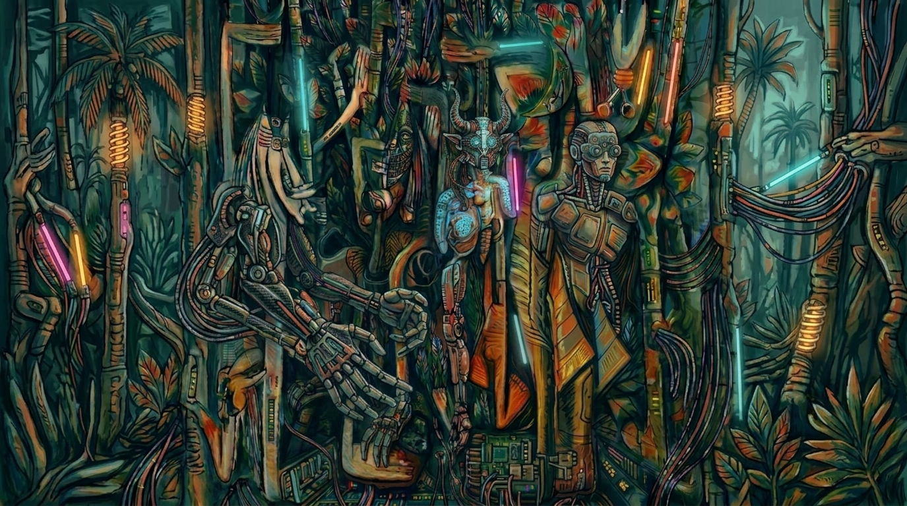
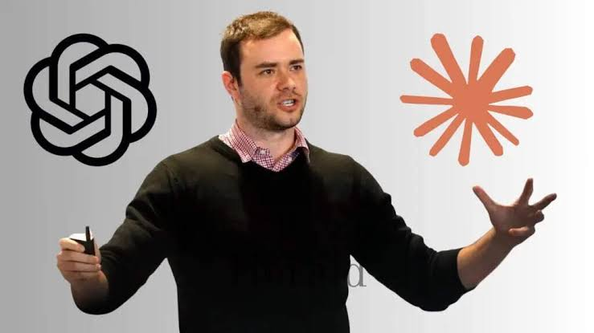
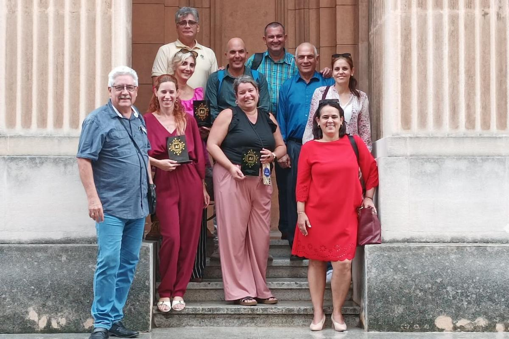
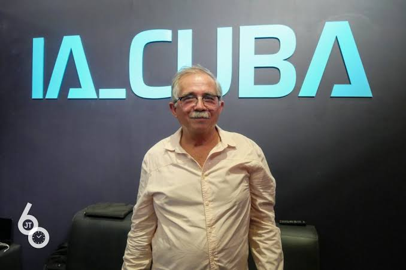
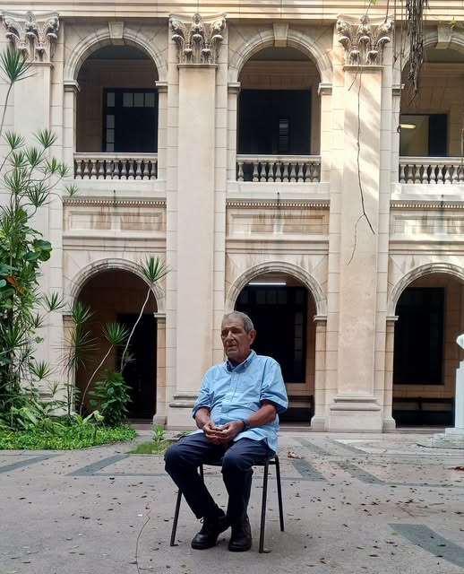
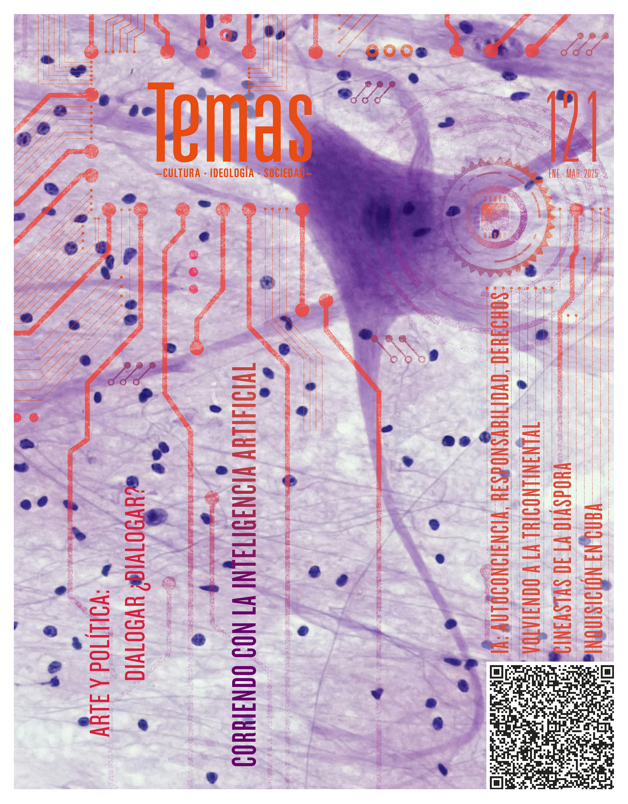

# Encuentro 001: La Jungla

Taller abierto de inteligencia artificial y sociedad

Centro de Recursos para el Aprendizaje y la Investigación 
Universidad de Pinar del Río

2026-11-03

 
 
<blockquote class="mt-4">

Rafael Martínez Estévez

</blockquote>

---
layout: default
class: caliban-deck
---

# La Jungla

Un territorio de relaciones complejas, formas de vida entrelazadas y transformaciones que no siempre resultan fáciles de interpretar.

---
layout: default
class: caliban-deck
---

# Agenda

### 1 · ¿Por qué Caliban?
El origen del nombre y su resonancia para pensar la tecnología.

### 2 · Panorama actual de la IA
Capacidades, brechas, transformación histórica y universidad.

### 3 · La IA en Cuba
Capacidades, experiencias, políticas y desafíos.

### 4 · Laboratorio
Creación y auditoría de la introducción de una tesis de pregrado.

---
layout: section
class: caliban-section
---

# 1 · ¿Por qué Caliban?

---
layout: default
class: caliban-deck
---

# Shakespeare y Fernández Retamar

**William Shakespeare · *La tempestad***
- Caliban: habitante de una isla
- Relación con Próspero: apropiación del territorio, imposición de autoridad y conflicto por el lenguaje

**Roberto Fernández Retamar · *Caliban* (1971)**
- El personaje subordinado se convierte en símbolo para pensar la dominación cultural y reconocernos desde nuestra propia experiencia

El lenguaje que se enseña como instrumento de sometimiento puede convertirse en un medio para cuestionar la autoridad y construir una voz propia. Apropiarse de un conocimiento no implica aceptar las condiciones en las que fue producido ni limitarse a reproducir los propósitos de quien lo transmite.

<blockquote class="mt-4">

«Me enseñaste tu lengua, y el provecho que saqué de ello es que sé maldecir».

</blockquote>

— Shakespeare, <em>La tempestad</em>, acto I, escena II

> «Nuestro símbolo no es, pues, Ariel, como pensó Rodó, sino Caliban. Esto es algo que vemos con particular nitidez los mestizos que habitamos estas mismas islas donde vivió Caliban: Próspero invadió las islas, mató a nuestros ancestros, esclavizó a Caliban y le enseñó su idioma para entenderse con él: ¿Qué otra cosa puede hacer Caliban sino utilizar ese mismo idioma para maldecir, para desear que caiga sobre él la «roja plaga»? No conozco otra metáfora más acertada de nuestra situación cultural, de nuestra realidad.».

— Roberto Fernández Retamar, <em>Caliban</em> (1971)

---
layout: default
class: caliban-deck
---

# Convertir la relación con la tecnología en pregunta abierta

¿Cómo podemos apropiarnos de las herramientas de nuestro tiempo sin renunciar a nuestra capacidad de pensar, crear y decidir?

¿Qué conocimientos necesitamos para pasar del consumo de tecnologías a la participación en su desarrollo?

¿Cómo podemos discutir sus posibilidades desde nuestras necesidades, experiencias y condiciones materiales?

- No partimos de respuestas predeterminadas
- Espacio para compartir experiencias y contrastar argumentos
- La biblioteca universitaria como lugar de encuentro

---
layout: section
class: caliban-section
---

# 2 · Panorama actual de la inteligencia artificial

---
layout: default
class: caliban-deck
---

# 2.1 Más allá de los chatbots

| Tipo de IA | ¿Qué permite? | Ejemplos |
|---|---|---|
| **Aprendizaje automático** | Identificar patrones, clasificar, estimar, predecir | Tendencias, clasificación, anomalías |
| **Aprendizaje profundo** | Representaciones complejas con redes multicapa | Imágenes, habla, lenguaje |
| **IA generativa** | Producir contenido nuevo | Textos, imágenes, audio, vídeo, código |
| **Modelos de lenguaje** | Procesar y generar lenguaje natural y código | Asistentes, análisis documental, escritura |
| **Sistemas con herramientas** | Modelos + buscadores, código, archivos | Flujos de trabajo, investigación |

⚠️ Las categorías se solapan. **No todas las formas de IA funcionan igual**, resuelven los mismos problemas ni presentan las mismas limitaciones.

---
layout: default
class: caliban-deck
---

# 2.2 La brecha en la percepción de la IA

<figure class="caliban-figure caliban-figure--wide">

</figure>

**Andrej Karpathy** · investigador e ingeniero

> Existe una creciente distancia entre las experiencias y percepciones de las capacidades de los modelos de lenguaje.

**Tres grupos coexistentes**

1. Apenas han interactuado con estos sistemas
2. Los usan para tareas relativamente sencillas
3. Profesionales experimentando con modelos avanzados para problemas complejos

**Pregunta clave:** ¿hasta qué punto nuestras ideas sobre la IA dependen de lo que hemos tenido la oportunidad de experimentar?

---
layout: default
class: caliban-deck
---

# 2.3 La IA en una transformación histórica

<figure class="caliban-figure caliban-figure--thumb">

</figure>

**Ignacio Ramonet** · *Un nuevo sistema histórico: Veinte apuntes para una Cartografía de la Nueva Transformación*

- El presente: convergencia de transformaciones geopolíticas, económicas, tecnológicas, energéticas, demográficas y ecológicas
- La IA no es una innovación independiente: forma parte de un cambio más amplio
- La tecnología como dimensión fundamental del poder: datos, cómputo, redes, centros de datos, modelos

- Productividad **no** equivale a distribución equitativa de beneficios
- Para Cuba: acceder a herramientas **y** formar profesionales, investigar, construir infraestructura
- Utilizar una plataforma **no** equivale a controlar sus condiciones

La pregunta deja de ser qué puede hacer la IA y pasa a incluir qué sociedad estamos construyendo con ella.

---
layout: default
class: caliban-deck
---

# Acceso desigual, poder concentrado

- Acceso desigual a modelos avanzados, dispositivos, conectividad, cómputo y conocimientos
- La IA puede ampliar capacidades **y** profundizar diferencias
- El desarrollo se concentra en pocas empresas y países
- Se concentra también el poder de definir cómo se desarrollan las tecnologías

**Preguntas que nos llevamos**

- ¿La IA democratiza el conocimiento o crea nuevas diferencias?
- ¿Qué ocurre cuando aprender e investigar dependen de plataformas externas?
- ¿Basta aprender a usar herramientas o necesitamos comprender las infraestructuras?
- ¿Cómo desarrollar capacidades propias para participar en la producción de conocimiento?

<figure class="caliban-figure caliban-figure--power">

</figure>

---
layout: default
class: caliban-deck
---

# 2.4 · La universidad ante la inteligencia artificial 

Informe de la UNESCO: **La implementación de la IA en la educación superior en América Latina y el Caribe**

Encuesta a **200 instituciones de 19 países** de América Latina y el Caribe, aplicada entre agosto y octubre de 2025.

### Adopción por ámbitos

- **87 %** utiliza IA en al menos un área
- **74 %** en enseñanza y aprendizaje
- **57 %** en investigación
- **34 %** en administración
- **20 %** en participación comunitaria

### Una adopción de abajo hacia arriba

El uso se extiende impulsado por docentes y estudiantes, mientras las estrategias y reglas institucionales avanzan con mayor lentitud.

El estudio ofrece una perspectiva regional; sus resultados deben leerse teniendo en cuenta el alcance y el diseño de la encuesta.

---
layout: default
class: caliban-deck
---

# El desfase de gobernanza

### Estrategias y reglas

- **26 %** tiene una estrategia formal de IA
- **19 %** cuenta con políticas específicas
- **8 %** dispone de presupuesto dedicado
- **57 %** no realiza monitoreo o evaluación del impacto

### Participación y protección estudiantil

- Solo **24 %** tiene directrices claras de integridad académica
- Apenas **8 %** incluye representación estudiantil en órganos de gobernanza

La cuestión no es simplemente adoptar herramientas: es decidir para qué, bajo qué condiciones y con qué responsabilidades.

---
layout: default
class: caliban-deck
---

# Decisiones universitarias desde nuestra realidad

### Enseñanza y aprendizaje
Preparación de materiales, explicación de conceptos y apoyo a ejercicios.

**Preguntas:** ¿cómo evaluar comprensión y pensamiento propio? ¿Cómo distinguir apoyo de delegación?

### Investigación
Revisión bibliográfica, análisis de datos, escritura de código y documentos.

**Preguntas:** ¿cómo verificar fuentes, resultados y procedencia? ¿Qué información es confidencial?

### Gestión
Automatización y organización de información y servicios.

**Preguntas:** ¿qué datos institucionales proteger? ¿Quién responde por decisiones automatizadas?

La universidad puede adoptar plataformas de forma inercial o utilizarlas críticamente, desarrollar capacidades propias y participar en su gobernanza.

---
layout: section
class: caliban-section
---

# 3 · La inteligencia artificial en Cuba
---
layout: default
class: caliban-deck
---

# 3.1 · Política nacional y articulación institucional

**Política para la Transformación Digital, Agenda Digital Cubana y Estrategia de Inteligencia Artificial** (2024)

- Reconoce la IA como motor del desarrollo socioeconómico en sectores clave.
- Identifica potencial científico y tecnológico en universidades y centros de investigación.
- Persiste una brecha entre las capacidades investigadoras, la articulación con el sector productivo y la creación de productos nacionales de uso extendido.

### Consorcio IA_CUBA
Presentado en noviembre de 2025; reúne **22 organizaciones fundadoras** de los ámbitos universitario, científico, empresarial y público.

### Asamblea General · 20 octubre 2026

<figure class="caliban-figure caliban-figure--float caliban-figure--float-lg">

</figure>

En la Universidad de La Habana se aprobaron los estatutos y la estructura de gobernanza del Consorcio.

---
layout: default
class: caliban-deck
---

# 3.2 · Universidad: regulación y tradición investigadora

### Universidad Central «Marta Abreu» de Las Villas

- Trabaja en un **Código de Ética** y un **Reglamento Interno** para orientar el uso de IA en docencia e investigación.
- Busca promover un uso transparente y declarado.
- La propuesta parte de que utilizar IA no significa delegar el razonamiento intelectual.

### Una tradición científica

<figure class="caliban-figure caliban-figure--float">

</figure>

- La UCLV posee una trayectoria reconocida en investigación sobre IA.
- Destaca el trabajo del profesor **Rafael Bello**, referente en la consolidación de esta área en Cuba.
- La discusión actual se apoya en una historia previa de investigación y formación.

En universidades como la de Camagüey, se reporta que el **86 %** de los estudiantes utiliza IA en sus estudios.

La regulación universitaria debe orientar y formar, no convertirse en un freno burocrático ni sustituir el juicio académico.

---
layout: default
class: caliban-deck
---

# 3.3 · Debate académico y pensamiento crítico

### Antecedentes

- En **1969**, Luciano García Garrido publicó un trabajo sobre lógica matemática e inteligencia artificial en la revista *Pensamiento Crítico*.
- En **abril de 2025**, la revista *Temas* dedicó su número 121 a la inteligencia artificial, con un enfoque multidisciplinar.

<figure class="caliban-figure">

</figure>

<figure class="caliban-figure">

</figure>

### Una idea para la universidad

> La IA debe ser un colaborador, no un sustituto del razonamiento.

— Luciano García Garrido, Universidad de La Habana

La capacidad operativa de las herramientas debe acompañar, no erosionar, la creatividad, la responsabilidad intelectual y el pensamiento crítico.

---
layout: default
class: caliban-deck
---

# 3.4 · Preguntas para el debate

### Gobernanza
¿Qué ventajas y desafíos presenta un consorcio nacional articulado desde el Estado frente a una adopción fragmentada y comercial?

### Normativa y pedagogía
¿Qué debe contener un código de ética para orientar el uso de IA sin convertirse en un freno burocrático?

### Soberanía y pensamiento crítico
¿Cómo resolver problemas locales con IA sin reproducir dependencias tecnológicas?

---
layout: section
class: caliban-section
---

# 4 · Laboratorio: creación y auditoría de la introducción de una tesis
---
layout: default
class: caliban-deck
---

# Punto de partida: Felix Rieseberg

**How to be more ambitious: A tutorial for humans with models** · 13 octubre 2026

En lugar de pedir simplemente que una herramienta redacte un documento, podemos comunicarle el **objetivo**, proporcionarle materiales relevantes, cuestionar los supuestos de partida y utilizar procedimientos externos para comprobar los resultados.

<strong>Velocidad</strong> Organizar y redactar con mayor eficiencia, sin confundir rapidez con calidad.

<strong>Nivel de abstracción</strong> Pasar del documento a la arquitectura lógica de la investigación.

<strong>Profundidad</strong> Examinar fuentes, datos, métodos y supuestos.

<strong>Amplitud</strong> Incorporar perspectivas disciplinares y criterios de evaluación.

---
layout: default
class: caliban-deck
---

# El ejercicio: introducción de una tesis de pregrado

Construir y auditar una introducción de **máximo siete páginas**, conforme a las orientaciones metodológicas de la universidad.

### Contexto y diseño teórico

- Contexto, marco teórico básico y antecedentes
- Situación problemática o contradicción
- Problema, objeto y objetivo
- Campo de acción, si es necesario
- Hipótesis, ideas a defender o preguntas científicas

### Diseño metodológico

- Tareas de investigación
- Sistema de métodos y aporte de cada uno
- Métodos de procesamiento de información empírica
- Población y muestra

**Actualidad e importancia:** necesidades reales del país, la provincia o la institución.

**Aportes prácticos y novedad científica:** contribución transformadora y elementos novedosos fundamentados.

No se espera terminar la introducción durante el encuentro. El propósito es comenzar el ejercicio y aprender un procedimiento que pueda continuarse después.

---
layout: default
class: caliban-deck
---

# Cuatro momentos de trabajo

1

<strong>Preparación y diagnóstico</strong> Examinar tema, contexto, problema preliminar, objeto, antecedentes y orientaciones. Identificar qué está definido, qué falta y qué se contradice.

2

<strong>Construcción asistida</strong> Organizar los componentes y, si el tiempo lo permite, redactar un primer borrador de algunos de ellos.

3

<strong>Auditoría metodológica y contraste</strong> Revisar presencia, fundamentación y coherencia. Contrastar afirmaciones y referencias con sus fuentes originales.

4

<strong>Revisión y continuidad</strong> Registrar problemas, correcciones y verificaciones pendientes. Conservar materiales y decisiones para continuar después.

Los vacíos no deben completarse automáticamente: deben quedar identificados como decisiones que corresponden al investigador.

---
layout: default
class: caliban-deck
---

# Matriz para auditar la introducción

| Componente | Pregunta de auditoría |
|---|---|
| Contexto y antecedentes | ¿Son pertinentes, verificables y conducen al problema? |
| Situación problemática | ¿Se apoya en hechos o necesidades concretas? |
| Problema y objeto | ¿Están delimitados y relacionados? |
| Objetivo | ¿Responde al problema y orienta las tareas? |
| Campo de acción | ¿Se incluye si es necesario y delimita el objeto? |
| Hipótesis / ideas / preguntas | ¿Corresponden a la naturaleza de la investigación? |
| Tareas | ¿Son acciones concretas que conducen al objetivo? |
| Métodos | ¿Forman un sistema coherente y justificado? |
| Procesamiento empírico | ¿Se corresponde con los datos obtenidos? |
| Población y muestra | ¿Están delimitadas y justificadas? |
| Actualidad e importancia | ¿Responden a necesidades reales? |
| Aportes prácticos | ¿Explican la contribución transformadora? |
| Novedad científica | ¿Identifica qué se incorpora de forma novedosa? |

Revisar cada componente en tres niveles: **presencia · fundamentación · coherencia**. La matriz guía la revisión; no sustituye la normativa ni la evaluación académica.

---
layout: default
class: caliban-deck
---

# ¿Qué queremos aprender?

### Interacción estructurada
¿Una interacción basada en objetivos, materiales y criterios produce mejores resultados que una petición genérica?

### Delegación y juicio
¿Qué tareas pueden asistirse y qué decisiones requieren el conocimiento y el juicio del investigador?

### Auditoría crítica
¿Cómo identificar errores, generalidades, contradicciones y afirmaciones sin respaldo?

### Comprobación externa
¿Qué procedimientos necesitamos para verificar fuentes, métodos y resultados?

La IA puede ayudar a estructurar, analizar y revisar; la responsabilidad científica sigue siendo del investigador.

---
layout: section
class: caliban-section
---

# Para continuar la conversación

---
layout: default
class: caliban-deck
---

# La Jungla es el punto de partida

**Próximos encuentros**

- Proyectos de curso de estudiantes de Informática
- Transformaciones en las editoriales
- Impactos en disciplinas que se estudian en la universidad (forestal, geología, etc.)

**Tres dimensiones en cada encuentro**

1. Comprender conceptos
2. Experimentar con herramientas
3. Discutir sus implicaciones

---
layout: default
class: caliban-deck
---

# Preguntas abiertas

¿Qué necesitamos aprender para comprender realmente las tecnologías de IA que usamos?

¿Cómo aprovechar sus posibilidades sin aceptar acríticamente sus resultados?

¿Qué capacidades científicas, técnicas y educativas necesitamos desarrollar desde nuestra universidad?

¿Cómo participar en la construcción de alternativas adecuadas a nuestras necesidades locales?

¿Qué queremos que la IA haga posible y qué decisiones no estamos dispuestos a delegar?

No esperamos respuestas inmediatas. Su valor está en ayudarnos a reconocer qué necesitamos investigar, discutir y experimentar.

---
layout: default
class: caliban-deck
---

# Materiales del encuentro

1. **Andrej Karpathy.** [Reflexión sobre la brecha en la percepción de las capacidades de los modelos de lenguaje](https://x.com/karpathy/status/2109361546505966046).

2. **Ignacio Ramonet.** [*Un nuevo sistema histórico: Veinte apuntes para una Cartografía de la Nueva Transformación*](https://tocororo.github.io/caliban/textos/001-ramonet).

3. **UNESCO.** [*La implementación de la IA en la educación superior en América Latina y el Caribe*](https://unesdoc.unesco.org/ark:/48223/pf0000399333_spa).

4. **Felix Rieseberg.** [*How to be more ambitious: A tutorial for humans with models*](https://felixrieseberg.com/how-to-be-more-ambitious-a-tutorial-for-humans-with-models/).

5. **MINCOM (2024).** [*Política para la Transformación Digital, Agenda Digital Cubana y Estrategia para el Desarrollo y Uso de la IA en Cuba*](https://api.oecd.ai/storage//policy-initiatives/Apr2026/117ojpi25umogvdp0g-Cuba%20Politica_de_Transformacion_Digital_de__Agenda_Digital_y_Estrategia.pdf).

6. **Revista Temas (2025).** [*Inteligencia artificial*](https://temas.cult.cu/revista/revista_datos/100), no. 121.

7. **Parque Científico Tecnológico de La Habana (2026).** [Asamblea General del Consorcio Cubano para la IA](https://www.3ce.cu/index.php/noticias/el-consorcio-cubano-para-la-inteligencia-artificial-celebra-asamble-general).

8. **EcuRed.** [Consorcio de Inteligencia Artificial de Cuba](https://www.ecured.cu/Consorcio_de_Inteligencia_Artificial_de_Cuba).

9. **UCLV.** [Por un uso ordenado de la inteligencia artificial](https://www.uclv.edu.cu/por-un-uso-ordenado-de-la-inteligencia-artificial/).

10. **Universidad de La Habana.** [Luciano García Garrido: «La IA es un colaborador, no un sustituto del razonamiento»](https://www.facebook.com/universidaduhcuba/posts/luciano-garc%C3%ADa-garrido-la-ia-es-un-colaborador-no-un-sustituto-del-razonamiento-/1613088047495355/).

---
layout: none
class: caliban-cover caliban-cover--full caliban-closing
---

# ¡Gracias!

Caliban · Taller abierto de inteligencia artificial y sociedad

<a href="https://tocororo.github.io/caliban/">https://tocororo.github.io/caliban</a>

