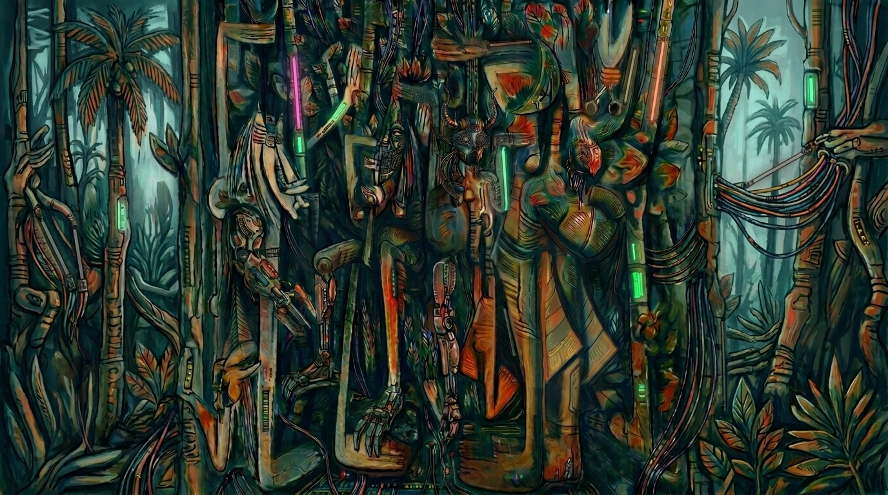
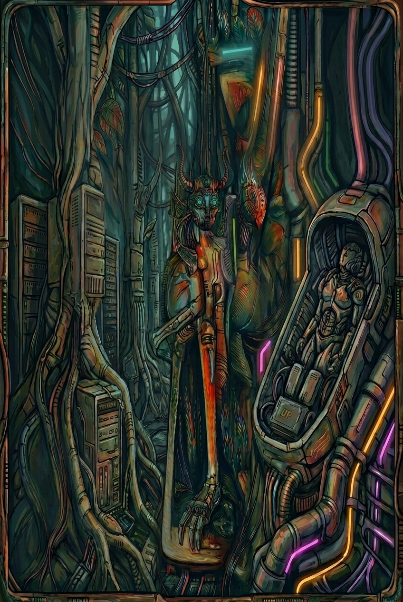

# Encuentro 001: La Jungla

Taller abierto de inteligencia artificial y sociedad

Centro de Recursos para el Aprendizaje y la Investigación 
Universidad de Pinar del Río

2026-11-03

---
layout: default
class: caliban-deck
---

# La Jungla

Un territorio de relaciones complejas, formas de vida entrelazadas y transformaciones que no siempre resultan fáciles de interpretar.

La imagen combina el universo visual de **Wifredo Lam** con la estética **ciberpunk** que inspira la identidad del taller.

---
layout: default
class: caliban-deck
---

# Agenda

### 1 · ¿Por qué Caliban?
El origen del nombre y su resonancia para pensar la tecnología.

### 2 · Panorama actual de la IA
Más allá de los chatbots, brechas de percepción y transformación histórica.

### 3 · La universidad ante la IA
Oportunidades, riesgos y decisiones desde nuestra realidad.

### 4 · Laboratorio
Creación y auditoría de documentos con IA generativa.

---
layout: section
class: caliban-section
---

# 1 · ¿Por qué Caliban?

---
layout: default
class: caliban-deck
---

# Shakespeare y Fernández Retamar

**William Shakespeare · *La tempestad***
- Calibán: habitante de una isla
- Relación con Próspero: apropiación del territorio, imposición de autoridad, conflicto por el lenguaje

**Roberto Fernández Retamar · *Calibán* (1971)**
- Relectura desde América Latina
- Pensar la dominación cultural y la posibilidad de reconocernos desde nuestra propia experiencia

> «Me enseñaste tu lengua, y el provecho que saqué de ello es que sé maldecir».

— Shakespeare, <em>La tempestad</em>, acto I, escena II

Una herramienta aprendida puede usarse de maneras que su creador no previó. Un lenguaje recibido puede convertirse en instrumento de cuestionamiento.

---
layout: default
class: caliban-deck
---

# Convertir la relación con la tecnología en pregunta abierta

¿Cómo podemos apropiarnos de las herramientas de nuestro tiempo sin renunciar a nuestra capacidad de pensar, crear y decidir?

¿Qué conocimientos necesitamos para pasar del consumo de tecnologías a la participación en su desarrollo?

¿Cómo podemos discutir sus posibilidades desde nuestras necesidades, experiencias y condiciones materiales?

- No partimos de respuestas predeterminadas
- Espacio para compartir experiencias y contrastar argumentos
- La biblioteca universitaria como lugar de encuentro
- Este blog como memoria abierta del taller

---
layout: section
class: caliban-section
---

# 2 · Panorama actual de la inteligencia artificial

---
layout: default
class: caliban-deck
---

# 2.1 Más allá de los chatbots

| Tipo de IA | ¿Qué permite? | Ejemplos |
|---|---|---|
| **Aprendizaje automático** | Identificar patrones, clasificar, estimar, predecir | Tendencias, clasificación, anomalías |
| **Aprendizaje profundo** | Representaciones complejas con redes multicapa | Imágenes, habla, lenguaje |
| **IA generativa** | Producir contenido nuevo | Textos, imágenes, audio, vídeo, código |
| **Modelos de lenguaje** | Procesar y generar lenguaje natural y código | Asistentes, análisis documental, escritura |
| **Sistemas con herramientas** | Modelos + buscadores, código, archivos | Flujos de trabajo, investigación |

⚠️ Las categorías se solapan. **No todas las formas de IA funcionan igual**, resuelven los mismos problemas ni presentan las mismas limitaciones.

---
layout: default
class: caliban-deck
---

# 2.2 La brecha en la percepción de la IA

**Andrej Karpathy** · investigador e ingeniero

> Existe una creciente distancia entre las experiencias y percepciones de las capacidades de los modelos de lenguaje.

**Tres grupos coexistentes**

1. Apenas han interactuado con estos sistemas
2. Los usan para tareas relativamente sencillas
3. Profesionales experimentando con modelos avanzados para problemas complejos

**Pregunta clave:** ¿hasta qué punto nuestras ideas sobre la IA dependen de lo que hemos tenido la oportunidad de experimentar?

---
layout: default
class: caliban-deck
---

# Acceso desigual, poder concentrado

- Acceso desigual a modelos avanzados, dispositivos, conectividad, cómputo y conocimientos
- La IA puede ampliar capacidades **y** profundizar diferencias
- El desarrollo se concentra en pocas empresas y países
- Se concentra también el poder de definir cómo se desarrollan las tecnologías

**Preguntas que nos llevamos**

- ¿La IA democratiza el conocimiento o crea nuevas diferencias?
- ¿Qué ocurre cuando aprender e investigar dependen de plataformas externas?
- ¿Basta aprender a usar herramientas o necesitamos comprender las infraestructuras?
- ¿Cómo desarrollar capacidades propias para participar en la producción de conocimiento?

---
layout: default
class: caliban-deck
---

# 2.3 La IA en una transformación histórica

**Ignacio Ramonet** · *Un nuevo sistema histórico: Veinte apuntes para una Cartografía de la Nueva Transformación*

- El presente: convergencia de transformaciones geopolíticas, económicas, tecnológicas, energéticas, demográficas y ecológicas
- La IA no es una innovación independiente: forma parte de un cambio más amplio
- La tecnología como dimensión fundamental del poder: datos, cómputo, redes, centros de datos, modelos

- Productividad **no** equivale a distribución equitativa de beneficios
- Para Cuba: acceder a herramientas **y** formar profesionales, investigar, construir infraestructura
- Utilizar una plataforma **no** equivale a controlar sus condiciones

La pregunta deja de ser qué puede hacer la IA y pasa a incluir qué sociedad estamos construyendo con ella.

---
layout: section
class: caliban-section
---

# 3 · La universidad ante la inteligencia artificial

---
layout: default
class: caliban-deck
---

# Marco de referencia: UNESCO

**La implementación de la IA en la educación superior en América Latina y el Caribe**

- Enseñanza, aprendizaje, evaluación, investigación y administración universitaria
- Dilemas éticos y desigualdades: equidad en el acceso, diversidad del conocimiento, protección de datos
- Necesidad de fortalecer las capacidades de las instituciones para comprender y gestionar estas tecnologías

Una perspectiva regional que traslada el debate desde las promesas de la industria hacia las condiciones concretas de nuestras instituciones.

---
layout: default
class: caliban-deck
---

# Dimensiones en la universidad

### Docencia
Preparar materiales, proponer ejercicios, explicar conceptos de distintas maneras.

**Riesgos:** respuestas incorrectas, dependencia excesiva, dificultad para evaluar.

### Investigación
Explorar bibliografía, analizar datos, escribir código, revisar documentos.

**Riesgos:** verificación, procedencia, confidencialidad, responsabilidad.

### Gestión
Apoyar tareas administrativas y de organización de la información.

**Riesgos:** consecuencias para las personas, transparencia, datos institucionales.

---
layout: default
class: caliban-deck
---

# Una discusión desde nuestra realidad

Las condiciones reales de acceso, conectividad, equipamiento y recursos condicionan lo que es posible.

- ¿Qué usos mejoran realmente la enseñanza y el aprendizaje?
- ¿Qué actividades modificar para evaluar la comprensión y el pensamiento propio?
- ¿Cómo distinguir ayuda legítima de delegación excesiva?
- ¿Qué datos universitarios no deberíamos introducir en servicios externos?

- ¿Qué responsabilidades al usar modelos que pueden producir información falsa?
- ¿Qué herramientas podemos usar o desarrollar de manera sostenible?
- ¿Cómo deberían participar estudiantes y profesores en las reglas de uso?

---
layout: section
class: caliban-section
---

# 4 · Laboratorio: creación y auditoría de documentos con IA

---
layout: default
class: caliban-deck
---

# Punto de partida: Felix Rieseberg

**How to be more ambitious: A tutorial for humans with models** (2026-10-13)

En lugar de pedir que una herramienta redacte un documento, podemos plantearle el **objetivo** que ese documento pretende alcanzar, proporcionarle materiales, solicitar que examine supuestos y usar procedimientos externos para comprobar el resultado.

<strong>Velocidad</strong> Mayor rapidez sin sacrificar la calidad

<strong>Abstracción</strong> Del documento al objetivo y su mejor camino

<strong>Profundidad</strong> Fundamentos, supuestos y criterios de evaluación

<strong>Amplitud</strong> Especialista, editor, bibliotecario, verificador

---
layout: default
class: caliban-deck
---

# El ejercicio: de un texto a un documento auditado

Elaborar una propuesta breve para organizar una actividad académica en la Biblioteca de la Universidad de Pinar del Río.

1

<strong>Creación</strong> Primera versión con contexto, propósito y requisitos.

2

<strong>Revisión crítica</strong> Afirmaciones a comprobar, información ausente, contradicciones.

3

<strong>Auditoría</strong> Coherencia, fundamentación, pertinencia y viabilidad.

4

<strong>Versión final</strong> Un documento que podamos explicar, revisar y defender.

---
layout: default
class: caliban-deck
---

# ¿Qué queremos aprender?

### Calidad
¿Una interacción más cuidadosa produce documentos mejores que una petición genérica?

### Delegación vs. decisión
¿Qué parte del trabajo delegamos y qué decisiones requieren nuestro juicio?

### Evaluación
¿Cómo evaluar una herramienta que produce textos convincentes sin garantizar corrección?

Pasar de la generación de contenido a la producción de resultados que podamos examinar y justificar.

---
layout: section
class: caliban-section
---

# 5 · Para continuar la conversación

---
layout: default
class: caliban-deck
---

# La Jungla es el punto de partida

**Próximos encuentros**

- Capacidades técnicas, aplicaciones y limitaciones de la IA
- Transformaciones en la producción del conocimiento
- Proyectos de curso de estudiantes de Informática

**Tres dimensiones en cada encuentro**

1. Comprender conceptos
2. Experimentar con herramientas
3. Discutir sus implicaciones

---
layout: default
class: caliban-deck
---

# Preguntas abiertas

¿Qué necesitamos aprender para comprender realmente las tecnologías de IA que usamos?

¿Cómo aprovechar sus posibilidades sin aceptar acríticamente sus resultados?

¿Qué capacidades científicas, técnicas y educativas necesitamos desarrollar desde nuestra universidad?

¿Qué queremos que la IA haga posible y qué decisiones no estamos dispuestos a delegar?

No esperamos respuestas inmediatas. Su valor está en ayudarnos a reconocer qué necesitamos investigar, discutir y experimentar.

---
layout: default
class: caliban-deck
---

# Materiales del encuentro

1. **Andrej Karpathy.** [Reflexión sobre la brecha en la percepción de las capacidades de los modelos de lenguaje](https://x.com/karpathy/status/2109361546505966046)
2. **Ignacio Ramonet.** [*Un nuevo sistema histórico: Veinte apuntes para una Cartografía de la Nueva Transformación*](https://tocororo.github.io/caliban/textos/001-ramonet)
3. **UNESCO.** [La implementación de la IA en la educación superior en América Latina y el Caribe](https://unesdoc.unesco.org/ark:/48223/pf0000399333_spa)
4. **Felix Rieseberg.** [*How to be more ambitious: A tutorial for humans with models*](https://felixrieseberg.com/how-to-be-more-ambitious-a-tutorial-for-humans-with-models/)
5. **Roberto Fernández Retamar.** *Calibán*. Ensayo de referencia para el nombre y el horizonte intelectual del taller.

---
layout: none
class: caliban-cover caliban-cover--full caliban-closing
---

# ¡Gracias!

Caliban · Taller abierto de inteligencia artificial y sociedad

Próximo encuentro: por anunciar 
<a href="https://github.com/tocororo/caliban">github.com/tocororo/caliban</a>

